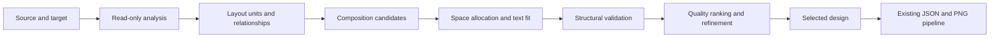

# GPT implementation plan: CHAMELEON layout engine

Date: 2026-10-07. Status: proposed implementation; no engine changes or new test results are implied by this document.

Build a deterministic engine that preserves the supplied design elements, proposes several group-aware compositions, fits text using the supplied fonts, and returns the strongest structurally valid candidate. Start with composition patterns and bounded search. Introduce a general solver or local model only after a benchmark demonstrates a specific benefit.

## 1. Scope and constraints

Keep the public entry point unchanged:

```python
resize(source: dict[str, Any], target_canvas: dict[str, Any]) -> dict[str, Any]
```

The returned object contains only `canvas` and `elements`, with the same element IDs and multiplicities as the source. Internal relationships, candidate scores, and diagnostics belong in separate development artifacts.

| Requirement | Implementation policy |
| --- | --- |
| Every element survives exactly once | Validate with ID counts, not sets; preserve output element order. |
| Preserve design content | Deep-copy the source. Initially change only `x`, `y`, `width`, `height`, and text `font_size`. Preserve all other fields, including style runs, rotations, opacity, grouping, assets, and stacking. |
| Preserve image proportions | Preserve the source element-box ratio for foreground images. Use the approximate 5% tolerance in `engine/resize.py` as a provisional local check, not a verified official tolerance. |
| Background cropping | Resize existing full-bleed background `cover` elements to the target. Do not convert foreground elements to `cover` to bypass proportion checks. |
| Preserve asset pixels | Inspect asset dimensions and alpha bounds read-only. Do not generate replacement imagery, rewrite assets, or add the intentionally missing badge. |
| Stay on canvas | Check element bounds after rotation and account conservatively for visible strokes. Keep output decorations inside even when the source deliberately bleeds outside. |
| Offline execution | Install everything at image-build time. No runtime API calls, downloads, font fetches, or dependency installation. |
| No hidden deletion | Do not use zero-sized boxes, new transparency, complete occlusion, or clipped text as shortcuts to retaining IDs. Record unavoidable visibility problems honestly. |

Foreground image-box proportions and visible artwork proportions are distinct: the existing `contain` implementation preserves artwork proportions inside a box even if that box has been stretched. Validate the JSON box contract and inspect rendered visibility separately.

A minimum readable font size is a quality preference, not an established submission rule. The schema minimum is 1px. Do not claim that every possible target supports complete, comfortably readable content.

## 2. Current state and prerequisite decisions

- `engine/resize.py` independently scales horizontal and vertical geometry and scales fonts by the smaller factor.
- `engine/main.py` loads tasks, writes artifacts, and performs a limited self-check. It can silently fall back to labeled boxes after an import failure and currently exits successfully despite self-check warnings.
- The converter is present under `renderer/converter/`; the external `cr-renderer` package is installed through `requirements.txt`.
- The samples exercise 4, 11, and 17 elements. Level 2 includes explicit groups, intentional decorative overlap, and intersecting subhead/CTA boxes. Level 3 includes 525 text characters, a rotated group, and a missing asset on a 728x90 target.
- The inspected local Python is 3.14.7; Pillow, cr-renderer, Skia, pytest, and jsonschema are not installed in that interpreter. The Docker runtime is Python 3.11. Use Python 3.11 for reproducible development.
- The main challenge brief, full rubric, official target catalogue, and finalized hardware/model-size limits are absent. Keep target lists and scoring preferences configurable until these arrive.

Before tuning layout quality, characterize the actual rendering path:

1. Import and call `render_design_to_png()` directly; a placeholder fallback must fail the development smoke check.
2. Verify measured widths, baselines, line advance, clipping, and rotation against isolated rendered fixtures.
3. Check `max_lines`: the converter does not consume it, so it cannot enforce text fit.
4. Check oversized words: `wrap_text()` does not split them.
5. Check style runs: schema endpoints are end-exclusive, while converter loops currently include the endpoint.
6. Check mixed-weight/style text and nonzero letter spacing: wrapping measures the base font before applying runs and does not pass spacing into `char_widths()`.
7. Verify actual PNG dimensions; the current render call uses a default maximum size of 2048, which may affect larger targets.

Preserve source styling. Document converter discrepancies with small reproducers; do not compensate by altering content or style-run indices. Only change the converter after establishing how that change relates to the official rendering behavior.

## 3. Proposed code organization

The README describes `resize.py` as the implementation entry point. Keep it as a thin orchestrator; helpers under `engine/` will be included by the existing Docker copy operation. If the missing main brief imposes a single-file restriction, fold the helpers into `resize.py` without changing the design.

| Proposed file | Responsibility |
| --- | --- |
| `engine/resize.py` | Preserve the API; analyze, generate, fit, select, validate, serialize. |
| `engine/layout_types.py` | Internal geometry, units, relationships, candidates, and diagnostics. |
| `engine/geometry.py` | Rotated corners, containment, intersections, group transforms, image fitting. |
| `engine/analyze.py` | Explicit groups, background classification, inferred relationships, importance estimates. |
| `engine/text_fit.py` | Renderer-compatible font lookup, wrapping, fit options, bounded measurement caches. |
| `engine/patterns.py` | Source-preserving placement, rows, columns, split layouts, variable-length group rows. |
| `engine/search.py` | Candidate generation, space allocation, deduplication, local refinement, work budgets. |
| `engine/quality.py` | Text visibility, harmful overlap, hierarchy, spacing, and source-relation penalties. |
| `engine/validate.py` | Structural contract checks independent of quality ranking. |
| `engine/config.py` | Explicit search budgets, margins, fit resolution, and quality preferences. |
| `scripts/benchmark.py` | Compare engines, collect metrics, render previews, produce reports. |
| `scripts/validate_outputs.py` | Validate written JSON/PNG artifacts; return nonzero on release failures. |
| `tests/` | Geometry, contract, typography, renderer, robustness, and integration tests. |
| `requirements-dev.txt` | pytest and jsonschema; keep development tooling outside production dependencies. |

Add `scripts/__init__.py` so the proposed tools can run with `python -m scripts...`. Keep generated reports under ignored `output/benchmarks/`; keep committed input fixtures separate under `tests/fixtures/`.

## 4. Internal model and pipeline



Use ordinary dataclasses for internal records:

- `Rect`: floating-point position and dimensions; methods for rotated corners and bounds.
- `LayoutUnit`: source member indices, source bounds, local coordinates, explicit/inferred grouping, importance, and allowed internal resizing mode.
- `Relationship`: endpoints, kind, confidence, and measured source relationship. Examples: shared alignment, containment, proximity, and stacking dependency.
- `TextFit`: width, font size, wrapped lines, measured line extents, required height, and overflow diagnostics.
- `Candidate`: composition tree, fitted design, structural errors, quality components, and deterministic candidate ordinal.
- `SearchReport`: candidate counts, prune reasons, fallback reason, unresolved visibility problems, and timing.

Suggested helper contracts:

```python
analyze(source, context) -> DesignAnalysis
generate_patterns(analysis, target, config) -> Iterable[Pattern]
fit_pattern(pattern, analysis, target, context) -> Candidate
validate(source, target, design) -> list[Violation]
measure_quality(analysis, candidate, context) -> QualityMetrics
select_candidate(candidates, config) -> Candidate
```

The internal context resolves brand assets/fonts relative to the repository/module root, reuses font managers, and bounds caches. The public `resize()` return value never includes the report. Benchmarks can call an internal reporting entry point; production logs can summarize diagnostics separately.

Determinism requires explicit iteration order, stable numeric precision, no random default search, and candidate-count budgets instead of wall-clock termination. Do not use lexical IDs as semantic signals or tie breakers. Array reordering should preserve decisions when source stacking order is unambiguous; preserve original paint order for equal `z_index` ties because those ties can change rendering.

## 5. Analysis and group behavior

1. Deep-copy source elements for serialization; retain source geometry separately.
2. Build explicit groups from non-null `group_id`. Every remaining element starts as a singleton.
3. Recognize backgrounds from existing fit mode, canvas coverage, geometry, and stacking. Avoid asset-name or ID checks. Uncertain background classification must not exempt a foreground image from proportion validation.
4. Identify shape-and-label containment within explicit groups. Such groups may change width and height while retaining label padding and stacking.
5. Use a shared group transform for arbitrary composite groups. Transform member centers coherently; preserve their rotation values and foreground image ratios. Do not independently clamp members after placement, which could break the group.
6. Infer optional text stacks and alignment relationships with confidence scores. Keep inferred relationships soft and avoid merging unrelated units solely because their bounding boxes intersect.
7. Estimate importance from font hierarchy, prominence, contrast, area, and position. Use a modest default when uncertain. Semantic classification such as legal copy is optional; it must not depend on sample IDs.

Source relationships describe evidence of intent, not universally correct constraints. Background-label containment is stronger evidence than an incidental source text/CTA intersection. Decorations can layer behind content; text covering unrelated text is normally harmful.

## 6. Composition generation and fitting

Always include a repaired, proportion-preserving source-layout candidate as the reference fallback. It uses uniform foreground scaling and anchored placement; it is distinct from the current stretch baseline.

Generate a small grammar of compositions:

- Source arrangement with redistributed whitespace.
- Vertical stack of units or text stacks.
- Horizontal strip of units with variable spacing.
- Two-column layouts in both image/copy orientations.
- Mixed layouts with a primary row and supporting row or footer.
- Variable-length rows or wrapped rows for repeated compact groups.

Patterns accept arbitrary unit counts and absent roles. Keep every unit assigned exactly once. Backgrounds and decorations are placed separately but remain original elements.

Use aspect change, canvas area change, estimated text demand, and unit count to prioritize patterns. Do not hard-code format names or claim the development target list is the official catalogue.

For each pattern:

1. Enumerate a bounded set of column splits, row allocations, margins, and gaps.
2. Fit foreground image boxes with one scale factor derived from their source box ratio.
3. Compute text-fit options for the allocated widths using the supplied font manager and wrapper.
4. Reallocate space before reducing text size further. Resize label backgrounds around fitted labels while respecting grouping.
5. Place units using rotated bounds, then place low-opacity decorations behind content.
6. Validate; deduplicate equivalent geometry; rank and refine the best few candidates by moving split boundaries or reallocating rows.

Start with proposed budgets of 64 fully fitted candidates and two refinement passes over the best eight. Keep these configurable and adjust after measuring quality and memory. They are development choices, not competition limits.

Cache text measurements by font-file identity, base weight/style, content, size, box width, spacing, and relevant runs. Bound cache entries and clear task-specific caches between large batches.

Font fitting should use a discrete size sweep initially. Binary search is an optimization only after checking monotonic fit behavior against the real wrapper. Measure widest-line overflow, baseline/ascent/descent, and total line height; line count alone is insufficient. Preserve the stored `content` string; renderer-internal wrapping does not justify rewriting it.

For irregular assets, alpha bounds can improve visibility/overlap estimates without cropping or changing the files. Structural checks continue to use the full element rectangle.

## 7. Validation, ranking, and graceful compromises

Separate hard validity from quality. A candidate can be schema-valid yet unreadable.

Hard validation checks:

- Target dimensions match exactly; schema validation passes in the test/release runner.
- Source IDs are unique and output ID counts match exactly. Invalid duplicate-ID sources receive an explicit input error.
- Element types and all preserved properties match their source counterparts.
- Coordinates, dimensions, and font sizes are finite; dimensions are nonnegative and text size is at least 1.
- Originally visible elements are not deliberately collapsed to zero size; opacity is preserved.
- Axis-aligned and rotated output bounds remain inside the canvas within a small numerical epsilon. Do not reuse the starter's half-pixel tolerance as an official rule.
- Non-background image box ratios remain within the provisional tolerance; degenerate source boxes are handled explicitly rather than divided by zero.
- Source dictionaries, nested style runs, fonts, and asset files are unchanged.

Quality ranking is a local proxy, not a reconstruction of the official rubric. Start with a staged ranking:

1. Prefer complete, unobscured text and preserved group containment.
2. Penalize severely small text and vanishing foreground imagery across the entire design; do not let one excellent headline hide unreadable supporting elements.
3. Prefer preserved typography hierarchy, useful contrast, and prominent primary units.
4. Prefer consistent alignment, gaps, whitespace, and balanced allocation.
5. Prefer confident source relationships and smaller unnecessary recomposition when other quality measures are comparable.

Keep component values visible in benchmark reports. Calibrate weights using feasible fixtures and human comparison; lock them before evaluating held-out cases. Retain a small set of candidates illustrating the tradeoff between complete text and readability for crowded targets.

If no candidate fits everything at preferred sizes, reduce gaps/padding, try more arrangements, and then lower size preferences. Never truncate copy or conceal elements. If even 1px text cannot fit an extreme valid target, return the best structurally valid design with explicit diagnostic overflow; classify the case as a quality failure, not successful text fitting. The release report must expose this condition.

Missing assets retain their IDs and original asset references. Use the renderer's existing placeholder behavior; do not create the missing holiday asset. Missing fonts need deterministic, documented local fallback behavior or an explicit setup error, never a network fetch.

## 8. Implementation milestones

| Milestone | Work | Exit evidence |
| --- | --- | --- |
| M0: reproducible baseline | Create Python 3.11 environment; pin a verified cr-renderer revision and dependency versions; render sources/current outputs; establish benchmark schema. | Real renderer smoke check passes; missing asset produces its expected warning; versions and baseline artifacts are recorded. |
| M1: geometry and contract | Implement rotated geometry, group transforms, serialization, and validation; add proportion-preserving anchored reference engine. | Contract tests pass; all sample outputs are structurally valid; no claim of improved readability yet. |
| M2: measured typography | Characterize renderer text placement; implement fit options and label containment. | Feasible typography fixtures have complete text inside bounds; oversize-word and run/spacing discrepancies are visible. |
| M3: composition patterns | Add stacks, strips, splits, and repeated-group rows with bounded space enumeration. | Level 2 groups remain intact; text is complete and rendered quality improves over the anchored reference without Level 1 regressions. |
| M4: search and ranking | Add deduplication, refinement, quality metrics, deterministic budgets, and crowded-target diagnostics. | Held-out variants improve on M3 according to recorded metrics and human review; Level 3 compromises are documented. |
| M5: packaging and viewer | Run production image offline; validate artifacts; build required Express viewer against confirmed add-on specifications. | Cold-start Docker batch passes release checks; viewer can inspect source/output and exact target dimensions. |
| M6: optional extensions | Trial a discrete solver or offline model only for failures found in M4. | Extension wins an ablation on held-out cases and passes the same offline/reproducibility checks. Otherwise omit it. |

Each milestone depends on the previous one. Keep the original stretch, anchored reference, patterns-only, and search-enabled implementations available to the development benchmark through adapters; production calls only the chosen engine.

## 9. Test strategy

Write tests for meaningful failure modes, not for every helper's implementation detail.

| Layer | Essential cases | Assertion/evidence |
| --- | --- | --- |
| Geometry | Rotations 0, -12, 45, 90; boundary placement; stroke extent; nested group positions. | Independently calculated corners/containment; groups remain coherent. |
| Contract | Dropped, duplicate, or invented IDs; changed content/assets/styles; nonfinite values; wrong target; source mutation. | Each deliberate defect is rejected; valid output passes the supplied schema. |
| Images | Source box ratio differs from native asset ratio; transparent asset; `contain`; original full-bleed `cover`; missing asset; degenerate source box. | Box contract and rendered artwork checks remain distinct; no invented assets or crashes. |
| Text | One/multiple lines; existing newlines; long unbroken word; whitespace; bold/italic; style runs; nonzero spacing; tiny box; supported non-ASCII copy. | Measured line extents agree with renderer diagnostics; fit never silently drops characters. Record font coverage limits. |
| Groups | Shape/label; variable badge count; rotated ribbon; heterogeneous group; coincident members. | Containment, shared placement, ratios, rotations, and stacking survive. |
| Layering | Decorative overlap; intentional grouped overlap; unrelated text collision; source subhead/CTA intersection. | Harmful and intentional overlap are distinguished; source mistakes are not enforced blindly. |
| Robustness | Renamed IDs/group IDs; removed sample notes; reordered elements; missing roles; more groups; changed copy. | No dependence on sample names/annotations; ordering invariance only where paint order is unambiguous. |
| Determinism | Repeated call; repeated fresh process; multiple tasks in different orders. | Stable serialized output in the pinned environment; no task-cache contamination. |
| Integration | Multiple input files; real fonts/assets; expected missing asset; output writes; strict renderer import. | One valid JSON/PNG pair per task; correct names/dimensions; warnings recorded; no placeholder-only renderer accepted. |
| Container | Clean image start; `--network none`; read-only input mount; output mount; sequential batch. | No runtime download, GPU assumption, asset mutation, unexpected failure, or missing artifacts. |

Use isolated render fixtures with known expected line counts and independent ink-bound checks. Avoid tests that merely call the same fit function twice. For rendered containment, render isolated elements with padded diagnostic canvases to detect overflow; these are development artifacts, never replacements for submission assets.

Use pixel-exact comparisons only for small stable fixtures in the pinned environment. For full designs, keep metrics and human review primary; cross-platform anti-aliasing can make exact snapshots misleading.

## 10. Benchmark corpus, reports, and acceptance

Keep three sets separate:

1. **Public samples:** reproduce all three tasks unchanged and report them individually.
2. **Development fixtures:** deliberately vary geometry, copy length, grouping, supported fonts, opacity, rotation, and target sizes while generating schema-valid source designs.
3. **Held-out fixtures:** freeze a separate set before tuning ranking weights; include independently arranged source designs, not only mutations of the three samples.

Use development targets such as 1080x1350, 1080x1080, 1920x1080, 1600x400, 728x90, and narrow portrait formats. They are representative test rectangles, not the official catalogue. Pair aspect-ratio changes with area changes to test both reflow and compression. Add tiny synthetic targets as stress tests with explicitly allowed quality failures.

Report each engine/case pair with:

- Schema and contract violations, categorized by element.
- Text line count, widest-line overflow, required-height overflow, and fitted font size per element.
- Count of text elements below configurable diagnostic thresholds, initially 6px and 10px. These thresholds are visibility indicators, not official requirements.
- Minimum/median text size, plus prominence and hierarchy changes; never use an average alone to declare success.
- Group containment violations and harmful overlap severity.
- Foreground image-box ratio error and visible artwork extent.
- Candidate count, prune reasons, fallback/overflow diagnostics, runtime, peak memory where measurable, and environment fingerprint.
- Source/output JSON, real rendered PNGs, and a side-by-side HTML contact sheet at native dimensions with optional zoom.

Benchmark reports should summarize structural failures before quality scores. Separate expected missing-asset warnings from unexpected errors. Record any render scaling so displayed ink sizes are interpreted correctly.

Release gates:

- Zero contract/schema violations across the supported benchmark corpus and public samples.
- Zero silent content/style changes, source mutation, or asset replacement.
- Zero text overflow on fixtures explicitly constructed to be feasible at the specified test sizes.
- Level 1 retains its hierarchy and proportional imagery; Level 2 has complete visible text and coherent groups, confirmed in real previews.
- Level 3 has a measured comparison against both stretch and anchored references, including complete-copy status, font sizes, and human inspection. Do not substitute a universal readability promise for this evidence.
- Renaming IDs and removing sample notes does not change layout decisions; permitted array reorderings preserve geometry by ID.
- Repeated runs are deterministic in the pinned environment.
- Offline Docker cold-start and batch artifact validation pass. Record speed/memory; establish resource gates when the reference budget is published.
- Human review checks native-size readability, brand faithfulness, hierarchy, deliberate layering, and missing-asset handling. A metric win alone cannot satisfy visual acceptance.

## 11. Development and release commands

These are the intended commands after the proposed scripts/tests exist. Creating this plan does not create or run those tools.

PowerShell development setup, with a Python 3.11 interpreter installed:

```powershell
py -3.11 -m venv .venv
.\.venv\Scripts\python.exe -m pip install -r requirements.txt -r requirements-dev.txt
.\.venv\Scripts\python.exe -m pytest -q
.\.venv\Scripts\python.exe -m engine.main
.\.venv\Scripts\python.exe -m scripts.validate_outputs --input-dir input --output-dir output --require-real-renderer
.\.venv\Scripts\python.exe -m scripts.benchmark --suite public --engines stretch anchored patterns search --report-dir output/benchmarks/public
.\.venv\Scripts\python.exe -m scripts.benchmark --suite heldout --engines anchored patterns search --report-dir output/benchmarks/heldout
```

The strict validator checks that the real renderer is available, validates artifact structure/dimensions, and independently reports quality failures. The benchmark invokes the real renderer directly and records provenance; a filename or nonempty PNG alone cannot prove the real renderer was used.

Production Docker smoke test:

```powershell
$taskRoot = (Get-Location).Path
$taskInput = Join-Path $taskRoot 'input'
$taskOutput = Join-Path $taskRoot 'output'
docker build --platform linux/amd64 -t chameleon-engine .
docker run --rm --network none --mount "type=bind,source=$taskInput,target=/app/input,readonly" --mount "type=bind,source=$taskOutput,target=/app/output" chameleon-engine
.\.venv\Scripts\python.exe -m scripts.validate_outputs --input-dir input --output-dir output --require-real-renderer
```

Run the container against a fresh, empty output directory as well so stale artifacts cannot satisfy the checks. A development image can install test dependencies and copy `scripts/`/`tests/` at build time to run the same integration checks inside Linux. Keep production dependencies and diagnostic artifacts minimal.

Pin the verified renderer revision and resolved package versions after M0. Ensure all production helpers are copied by Docker. Do not assume the M5 host exposes GPU/Metal acceleration to the Linux amd64 container.

## 12. Viewer, extensions, and open decisions

The Express viewer is required but described as unscored in the FAQ. Confirm the add-on specification before choosing SDK calls or a build scaffold. Its initial scope is loading source/output, showing exact target dimensions, comparing real previews, exposing diagnostics, and selecting among development candidates if the submission interface permits it. A benchmark HTML contact sheet supports development but does not fulfill the required add-on.

Optional discrete optimization should select measured text-fit choices and layout assignments rather than encode font rendering directly. Introduce it only if bounded enumeration demonstrably fails on irregular unit counts or allocations.

An optional local model may estimate uncertain relationships or rank already valid candidates. It cannot rewrite stage-one copy, generate imagery, bypass validation, or call an external API at runtime. Establish CPU/container feasibility, model-size limits, licensing, and public access to any adapted weights before depending on it. Keep the deterministic engine as a measured fallback.

Resolve these questions as challenge materials arrive:

- Official rubric weights and whether all targets are expected to support fully readable complete copy.
- Exact reference CPU/RAM, execution architecture, GPU availability, and image/model size limits.
- Official target catalogue and asset/font availability for hidden designs.
- Official renderer/version, style-run endpoint behavior, text clipping, and preview resolution.
- Foreground image ratio tolerance and whether decorative output bleeding has any exception.
- Submission requirements for helper modules, the viewer, and input/output artifacts.

Implementation can begin through M4 without answering all of these, provided the unknowns remain explicit and the policies configurable.

Repository references: [README](README.md), [rules](RULES.md), [FAQ](FAQ.md), [schema](chameleon_design_schema_v0.9.json), [engine contract](engine/resize.py), [orchestrator](engine/main.py), [converter](renderer/converter/convert.py), [text wrapper](renderer/converter/wrap.py), and [asset fitting](renderer/converter/assets.py).
